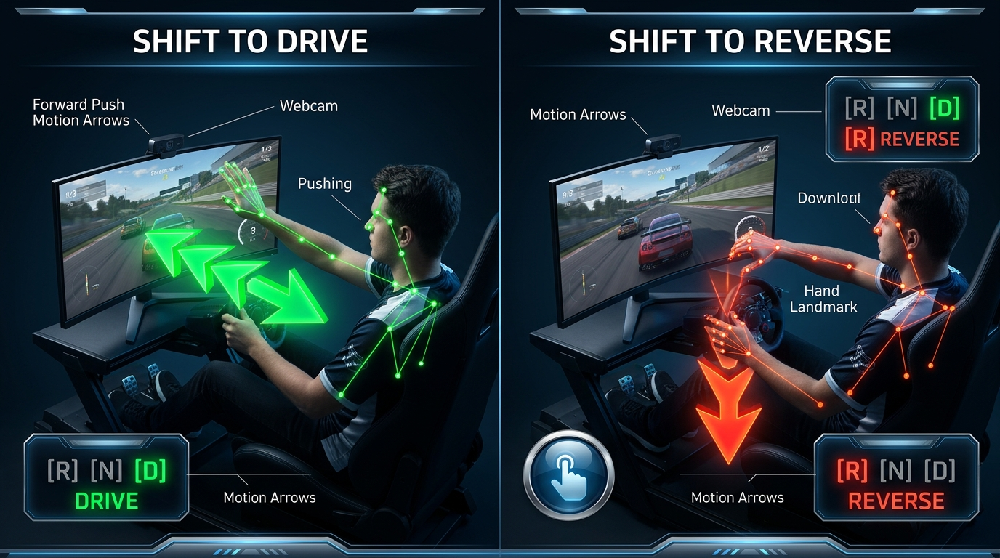

# 🚛 AI Visual Hand-Tracking Steering Wheel

A real-time computer vision driving controller that turns any standard webcam or **smartphone camera** into an authentic virtual steering wheel for **American Truck Simulator (ATS)**, **Euro Truck Simulator 2 (ETS2)**, **Forza Horizon**, **Assetto Corsa**, and other PC racing games.


---

## 🌟 Highlights

- **Anti-Twitch Progressive S-Curve Steering**: Near center ($0^\circ - 15^\circ$), response is ultra-forgiving and silky smooth for rock-steady highway cruising at 65+ MPH without jerky lane weaving. Ramps up smoothly to 100% full lock for tight 90° city intersections and trailer parking.
- **Continuous Hand-Over-Hand 360°/900° Rotation**: Anatomical handedness classification (Left vs. Right) with absolute vector tracking $\vec{V} = \text{RightHand} - \text{LeftHand}$ allows crossing hands completely without angular flips or drift.
- **Dual Vehicle Driving Profiles (`[V]` Key)**:
  - 🚛 **TRUCK (Heavy Hauler - ATS / ETS2)**: 70.0° deep steering range, 3.5° deadzone, 2.4 S-curve exponent, classic 4-spoke heavy commercial truck wheel.
  - 🏎️ **SPORT (Mustang GT / Supercars - Forza / Assetto Corsa)**: 38.0° fast 14:1 sports steering rack, 1.8° tight deadzone, 1.6 S-curve exponent for crisp turn-in, rapid drift counter-steering, and flat-bottom Mustang GT racing wheel.
- **🎮 Simultaneous Physical Xbox Controller Pass-Through**: Connect your physical Xbox controller anytime! Hand tracking controls steering, while your physical controller's analog triggers (RT for Gas, LT for Brake), right thumbstick (in-cab 360° camera look-around), and face buttons merge seamlessly into the game.
- **⚡ Dual Controller Emulation (Zero Name Collision - `[G]` Key)**: Emulates a Sony DualShock 4 (`"Wireless Controller"`) by default. Windows and games distinguish between your physical controller (`"Controller (XBOX 360)"`) and virtual wheel without device name conflicts. Toggle between DualShock 4 and Xbox 360 mode anytime with `[G]`.
- **🕹️ Transmission Gear Shifting Movements**: 
  - **Drive (`[D]` / 1st Gear)**: Push right hand forward toward screen.
  - **Reverse (`[R]`)**: Pull left hand downward.
  - **Neutral (`[N]`)**: Press key `[N]`.
  *(Automatically locked during two-hand steering to prevent accidental reverse while turning!)*
- **🖼️ Photorealistic 3D Steering Wheel HUD**: Renders authentic rotating steering wheels with 10-and-2 contoured thumb rests, red 12 o'clock racing centering stripe, brushed gunmetal spokes with speed holes, and center GT / ATS emblems.
- **📱 Phone-as-Webcam Support**: Full plug-and-play support for DroidCam, Iriun Webcam (USB/Wi-Fi), and IP Webcam wireless streams.
- **📖 Illustrated Word User Manual Included**: Complete illustrated manual with diagrams at [`ATS_Visual_Driving_User_Manual.docx`](./ATS_Visual_Driving_User_Manual.docx).

---

## 🎮 Driving & Gesture Controls

| Control | Gesture / Action | In-Game Binding | On-Screen HUD Visual |
| :--- | :--- | :--- | :--- |
| **Steering Wheel** | Hold both hands up at 9-and-3 o'clock; tilt left/right. | Gamepad Left Stick X | Rotating photorealistic wheel & angle readout |
| **Hand-Over-Hand Cross** | Cross hands continuously through 180°–900°. | Analog multi-turn | Smooth continuous rotation without phase windup |
| **Accelerate (Gas)** | Right Hand Pinch (or physical Xbox RT Trigger). | Right Trigger (RT) | Green analog bar: `GAS 0% -> 100%` |
| **Brake / Stop** | Left Hand Pinch (or physical Xbox LT Trigger). | Left Trigger (LT) | Red analog bar: `BRAKE 0% -> 100%` |
| **Shift to DRIVE [D]** | Push Right Hand forward toward screen (1-hand gesture). | Button A / Shift Up | Green HUD badge: `[D]` + alert banner |
| **Shift to REVERSE [R]** | Pull Left Hand downward (1-hand gesture). | Button X / Shift Down | Red HUD badge: `[R]` + alert banner |
| **Shift to NEUTRAL [N]** | Press keyboard key `[N]`. | Button Y / Neutral | Yellow HUD badge: `[N]` |
| **Toggle Vehicle Profile** | Press keyboard key `[V]`. | Truck $\leftrightarrow$ Mustang GT | Profile badge: `[V] TRUCK` / `[V] SPORT` |
| **Toggle Gamepad Device** | Press keyboard key `[G]`. | DualShock 4 $\leftrightarrow$ Xbox 360 | Device badge: `[G] DS4` / `[G] Xbox 360` |

---

## 📸 Transmission Gear Shifting Guide



1. **Shift to DRIVE (`[D]` / 1st Gear)**: Take one hand off the wheel and push your **Right Hand forward** toward the camera. Button `A` pulses to the game and shifts into forward gear.
2. **Shift to REVERSE (`[R]`)**: Take one hand off the wheel and pull your **Left Hand downward**. Button `X` pulses to the game and engages reverse gear.
3. **Shift to NEUTRAL (`[N]`)**: Press **`[N]`** on your keyboard to instantly select Neutral transmission.
4. **Safety Interlock**: Gear shifting gestures are **automatically disabled while both hands are actively steering**, ensuring turning corners will never accidentally shift into reverse!

---

## 🏎️ Vehicle Profiles: Semi-Truck vs. Mustang GT

Press **`[V]`** anytime while driving to switch between heavy hauling and high-speed racing:

| Specification | **TRUCK Profile (ATS / ETS2)** | **SPORT Profile (Mustang GT / Supercars)** | Real-World Driving Advantage |
| :--- | :--- | :--- | :--- |
| **Steering Lock Angle** | $70.0^\circ$ (Deep commercial turn) | **$38.0^\circ$ (Fast 14:1 rack)** | Lightning-fast sports car steering |
| **Center Deadzone** | $3.5^\circ$ (Highway calm) | **$1.8^\circ$ (Direct road feel)** | Immediate steering response with zero lag |
| **S-Curve Exponent** | $2.4$ (Heavy chassis damping) | **$1.6$ (Crisp progressive bite)** | Rapid counter-steering & drifting control |
| **Steering Wheel HUD** | Heavy Commercial 4-Spoke Wheel | **Flat-Bottom Mustang GT Racing Wheel** | Authentic visual cockpit immersion |

---

## 🎮 Using a Physical Xbox Controller + Hand Steering

1. Plug in your physical Xbox 360 / Xbox One / Series X controller via USB or Bluetooth.
2. Launch `run.bat` (defaults to DualShock 4 `"Wireless Controller"` emulation).
3. In your game's **Controls Settings**:
   - Both devices will be listed with distinct names:
     - `Controller (XBOX 360 For Windows)` (Physical Gamepad)
     - `Wireless Controller` (Hand Steering Wheel)
   - Assign **Steering Axis** $\rightarrow$ `Wireless Controller Left Stick X`.
   - Assign **Throttle / Brake / Buttons** $\rightarrow$ `Controller (XBOX 360) RT / LT / Buttons`.
4. Our software also supports **Unified Pass-Through**: Even in single-controller games (like Forza Horizon), physical RT/LT triggers and right thumbsticks merge directly into the virtual controller!

---

## 📱 No Webcam on your Laptop? Use Your Phone!

If using a laptop with no built-in webcam, any smartphone can be used as an ultra-low latency camera:

### Option A: DroidCam or Iriun Webcam (Recommended — 60 FPS USB & Zero Lag)
1. Install **DroidCam** or **Iriun Webcam** from Google Play Store (Android) or Apple App Store (iOS).
2. Install the free client on the laptop:
   - [Iriun Webcam Client](https://iriun.com/) or [DroidCam PC Client](https://www.dev47apps.com/)
3. Connect the phone via **USB Cable** (recommended for zero latency) or local **Wi-Fi**.
4. Double-click `run.bat` — the software detects your phone camera automatically!

### Option B: Wireless IP Webcam (Direct Wi-Fi Stream)
1. Install **IP Webcam** (free on Android).
2. Open the app, scroll to the bottom, and tap **Start Server**.
3. Note the IP address shown on the phone screen (e.g. `http://192.168.1.15:8080`).
4. In `config.py`, set:
   ```python
   CAMERA_SOURCE = "http://192.168.1.15:8080/video"
   ```
5. Double-click `run.bat` — it streams directly from the phone wirelessly!

---

## 🚀 Quick Start

### 1. Drive in American Truck Simulator or Racing Games
Double-click:
```bash
run.bat
```

### 2. Play the Built-in Highway Demo (No ATS Needed!)
Double-click:
```bash
play_demo.bat
```

### 3. One-Time Gamepad Driver Setup (If Needed)
If games do not detect the virtual controller on first launch, right-click and Run as Administrator:
```bash
install_gamepad_driver.bat
```

---

## ⌨️ In-App Hotkeys

- **`[V]`**: Toggle Vehicle Profile (**`TRUCK (ATS)`** $\leftrightarrow$ **`SPORT (MUSTANG GT)`**).
- **`[G]`**: Toggle Virtual Gamepad Device (**`DualShock 4`** $\leftrightarrow$ **`Xbox 360`**).
- **`[C]`**: Calibrate wheel center (sets current hand position to $0.0^\circ$).
- **`[N]`**: Shift to Neutral transmission (`[N]`).
- **`[O]`**: Toggle Always-on-Top Mini Picture-in-Picture (PiP) HUD mode.
- **`[M]`**: Switch Gamepad (Analog) $\leftrightarrow$ Keyboard (DirectInput) mode.
- **`[P]`**: Pause / Resume inputs.
- **`[Q]` / `[ESC]`**: Exit cleanly.

---

## 📖 User Manual
A complete, non-technical, illustrated user manual with AI diagrams is included in the root directory:
👉 **[`ATS_Visual_Driving_User_Manual.docx`](./ATS_Visual_Driving_User_Manual.docx)**

---

## 🛠️ Requirements & Manual Installation (For Developers)

If running from source rather than the bundled portable package:

```bash
git clone https://github.com/mRcOol7/hand-tracking-driving-simulator.git
cd hand-tracking-driving-simulator
pip install -r requirements.txt
python main.py
```
